# Luồng hoạt động các chức năng

Các sơ đồ viết bằng **Mermaid**: GitHub và khung xem trước Markdown của VS Code tự vẽ thành hình.
Muốn chèn vào Word / PowerPoint: dán từng khối vào <https://mermaid.live> → *Actions* → tải PNG/SVG.

| # | Sơ đồ | Loại |
|---|---|---|
| 1 | [Kiến trúc tổng thể](#1-kiến-trúc-tổng-thể) | thành phần |
| 2 | [Điều hướng màn hình theo vai trò](#2-điều-hướng-màn-hình-theo-vai-trò) (2a vai trò, 2b router) | flowchart |
| 3 | [Xử lý 1 request REST (bảo mật JWT)](#3-xử-lý-1-request-rest-bảo-mật-jwt) | sequence |
| 4 | [Đăng ký / đăng nhập mật khẩu](#4-đăng-ký--đăng-nhập-bằng-mật-khẩu) | sequence |
| 5 | [Đăng nhập Google (Firebase)](#5-đăng-nhập-google-firebase-authentication) | sequence |
| 6 | [Khách vãng lai → giỏ hàng → đặt món](#6-khách-vãng-lai--giỏ-hàng--đặt-món) | flowchart |
| 7 | [Đặt đơn (bên trong máy chủ)](#7-đặt-đơn-bên-trong-máy-chủ) | sequence |
| 8 | [Vòng đời trạng thái đơn](#8-vòng-đời-trạng-thái-đơn) | state |
| 9 | [Nhân viên xử lý đơn → khách nhận thông báo](#9-nhân-viên-xử-lý-đơn--khách-nhận-thông-báo) | sequence |
| 10 | [Thông báo trong app + đẩy FCM](#10-thông-báo-trong-app--thông-báo-đẩy-fcm) | sequence |
| 11 | [Chat AI](#11-chat-ai) | flowchart |
| 12 | [Quản lý thực đơn (CRUD tổng quát)](#12-quản-lý-thực-đơn-crud-tổng-quát) | sequence |
| 13 | [Thống kê doanh thu](#13-thống-kê-doanh-thu-admin) | sequence |
| 14 | [Dùng khi mất mạng (SQLite trên máy)](#14-dùng-khi-mất-mạng-sqlite-trên-điện-thoại) | flowchart |

---

## 1. Kiến trúc tổng thể

Một máy chủ duy nhất (Spring Boot, cổng 8090) vừa phục vụ giao diện PWA vừa cung cấp REST API.
App Android chứa sẵn bản sao giao diện, chỉ gọi REST API qua mạng.

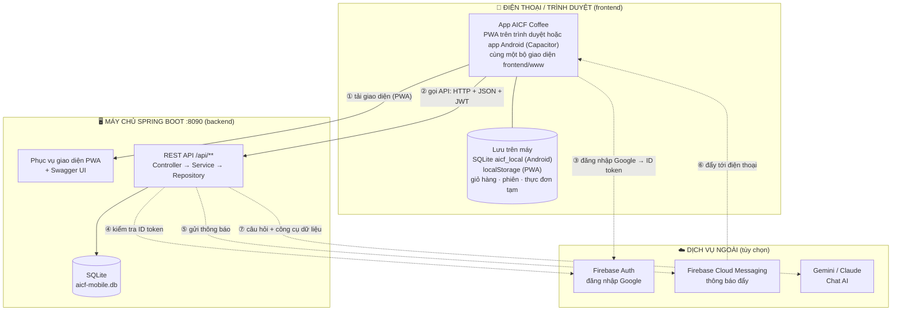

---

## 2. Điều hướng màn hình theo vai trò

**2a. Mỗi vai trò thấy gì.** Khách chưa đăng nhập vẫn xem thực đơn và dùng giỏ hàng; tới lúc cần tài khoản mới phải đăng nhập.

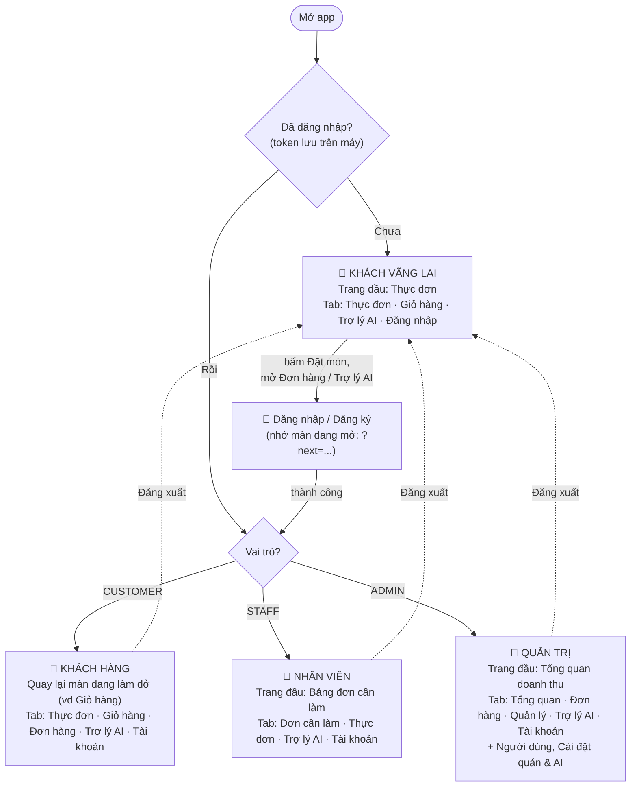

**2b. Router kiểm tra mỗi lần đổi màn** (`js/core/router.js`):

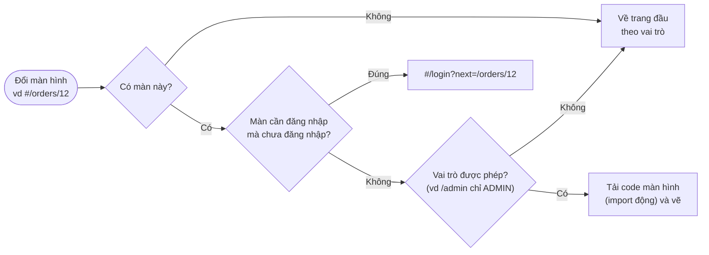

---

## 3. Xử lý 1 request REST (bảo mật JWT)

Mọi API đi qua cùng một đường: bộ lọc JWT → luật quyền → Controller → Service → Repository → SQLite. Lỗi ở bất kỳ bước nào đều được đổi thành cùng một dạng JSON.

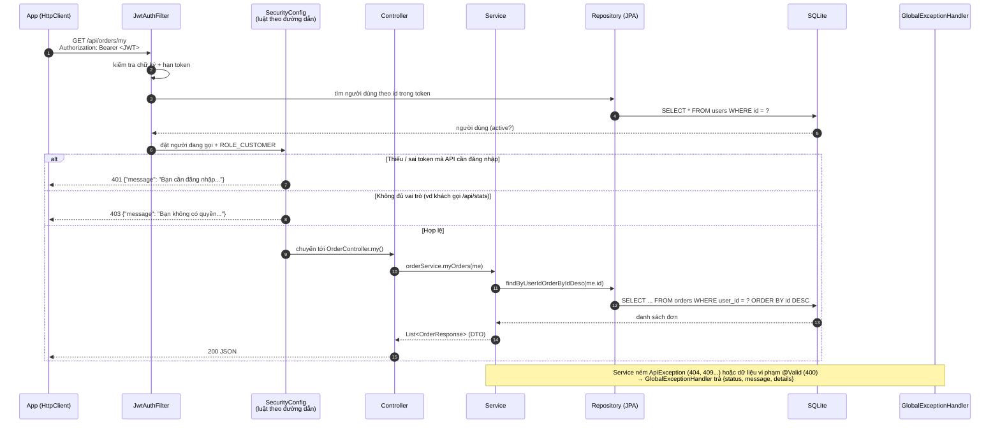

---

## 4. Đăng ký / đăng nhập bằng mật khẩu

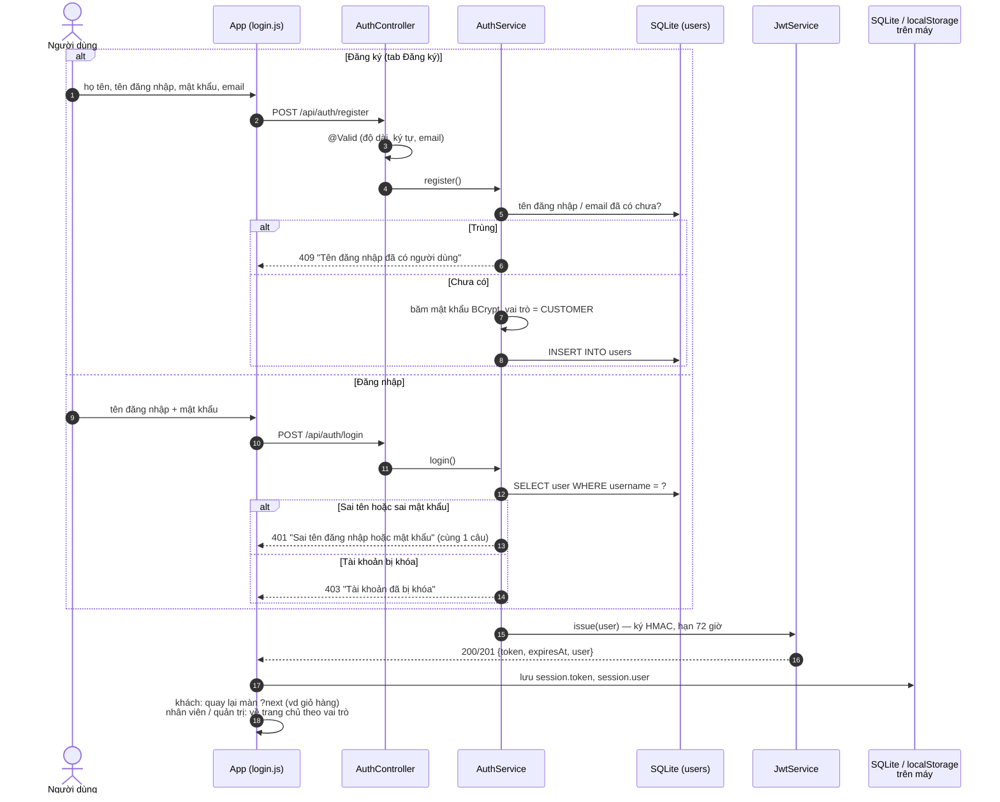

---

## 5. Đăng nhập Google (Firebase Authentication)

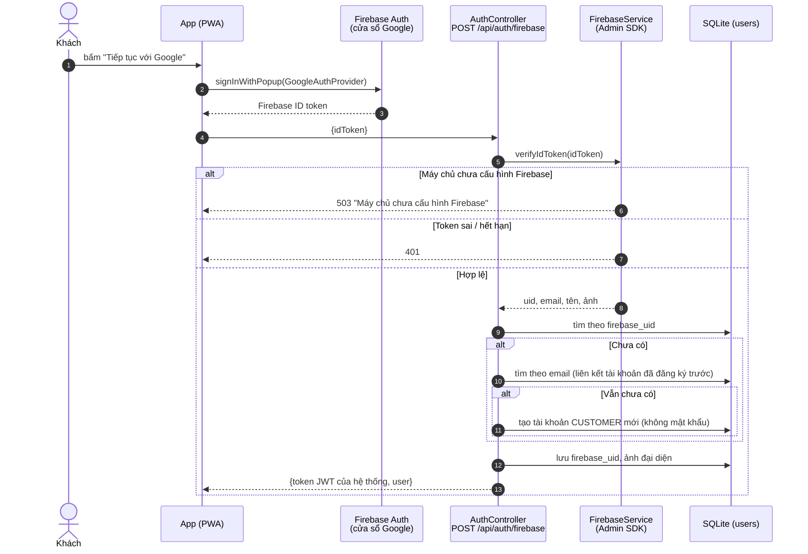

---

## 6. Khách vãng lai → giỏ hàng → đặt món

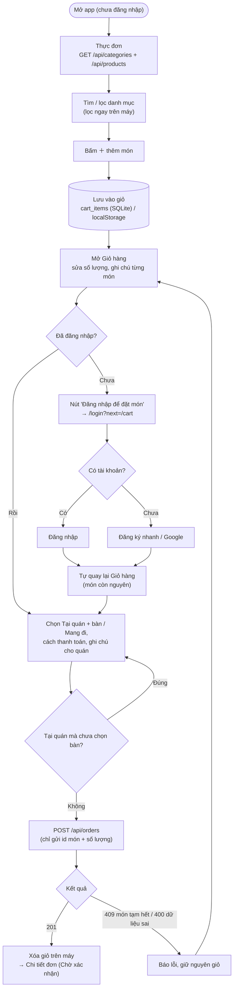

---

## 7. Đặt đơn (bên trong máy chủ)

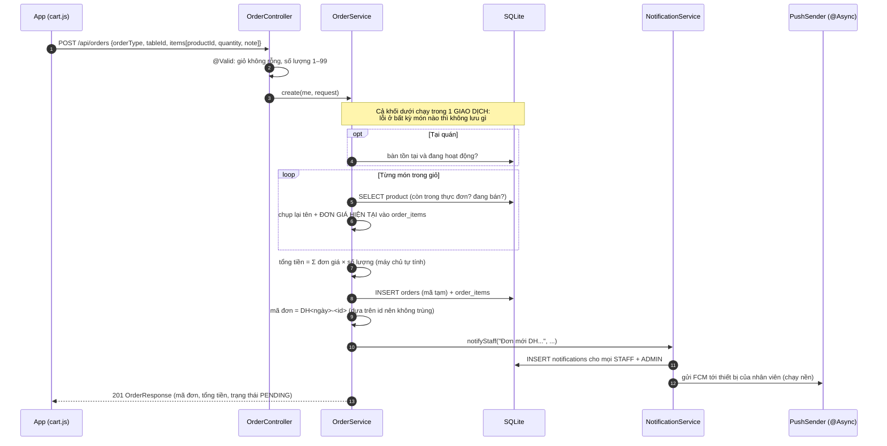

---

## 8. Vòng đời trạng thái đơn

Luật chuyển trạng thái nằm ở **một chỗ** (`OrderStatus.canMoveTo`). Chuyển sai luật → 409.

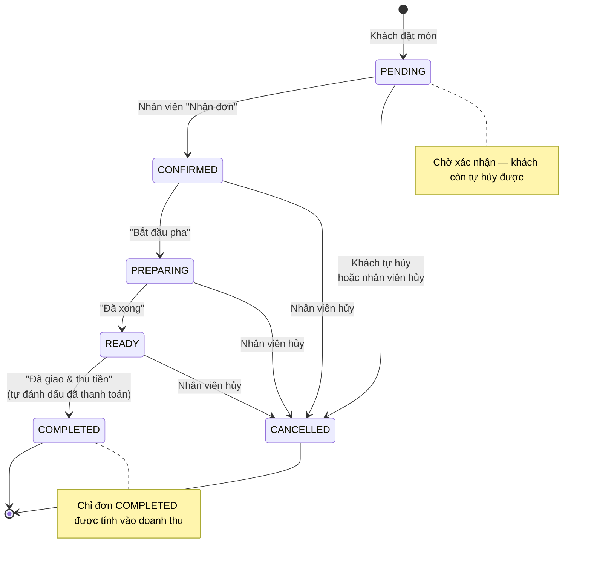

---

## 9. Nhân viên xử lý đơn → khách nhận thông báo

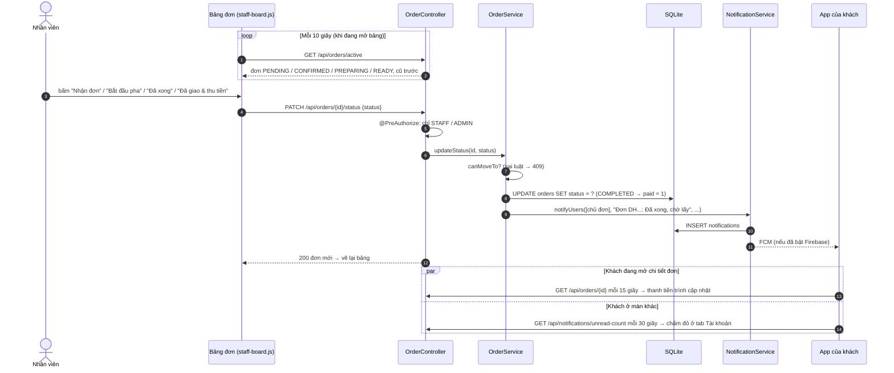

---

## 10. Thông báo trong app + thông báo đẩy (FCM)

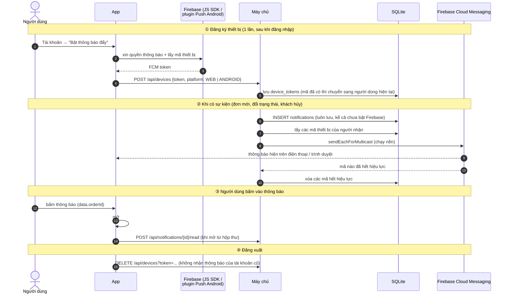

---

## 11. Chat AI

Tận dụng thiết kế Trợ lý AI của dự án AICF: chọn nhà cung cấp (Strategy), AI chỉ lấy số liệu qua **công cụ** (function calling), lỗi thì tự chuyển sang chế độ cơ bản.

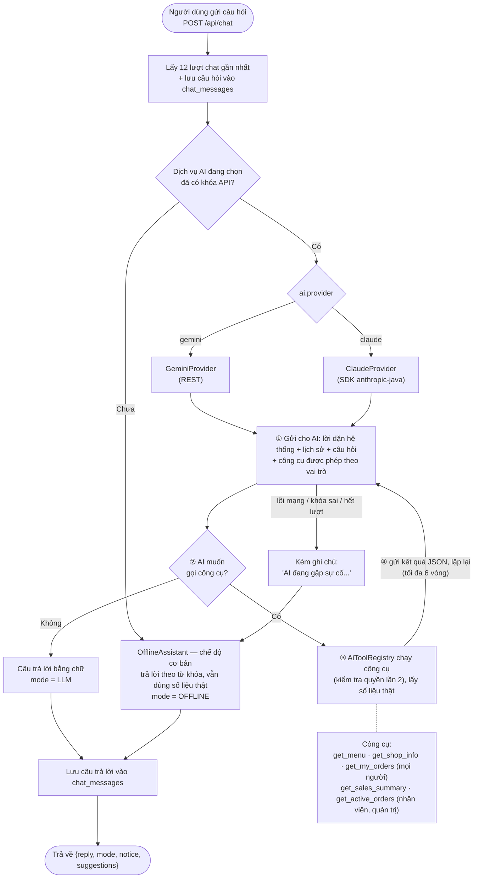

---

## 12. Quản lý thực đơn (CRUD tổng quát)

Món, Danh mục, Bàn dùng **chung một khung** ở cả hai phía: `crudPage()` + `createCrudRepository()` trên app, `CrudController` + `CrudService` trên máy chủ.

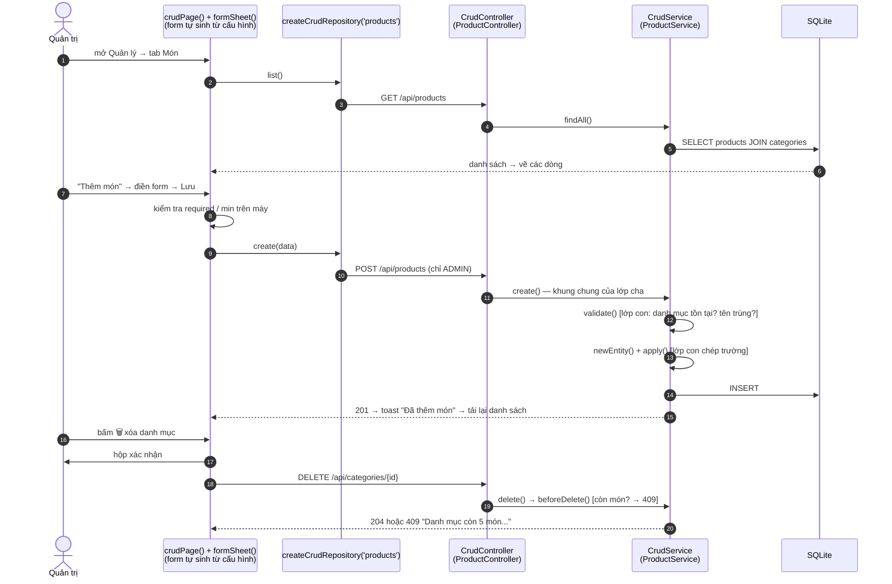

---

## 13. Thống kê doanh thu (Admin)

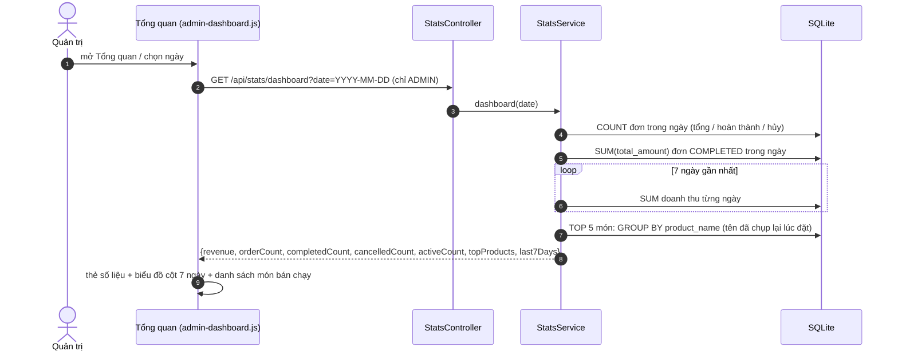

---

## 14. Dùng khi mất mạng (SQLite trên điện thoại)

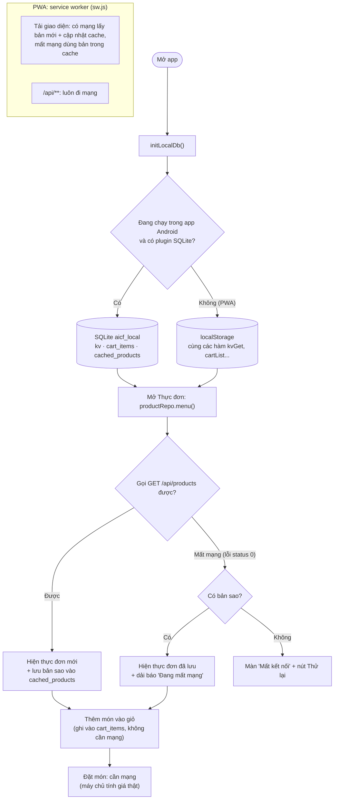
